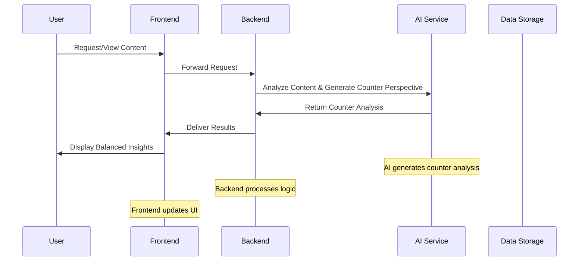
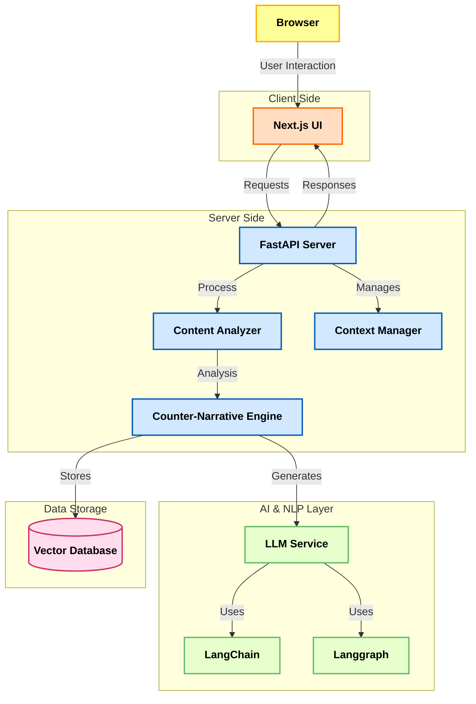

# Perspective-AI


[](https://github.com/AOSSIE-Org/Perspective/actions/workflows/frontend-ci.yml) [](https://github.com/AOSSIE-Org/Perspective/actions/workflows/deploy-frontend-pages.yml) [](https://github.com/AOSSIE-Org/Perspective/actions/workflows/deploy-backend-to-hf.yml) [](https://scorecard.dev/viewer/?uri=github.com/AOSSIE-Org/Perspective)

### Table of Contents
- [Perspective-AI](#perspective-ai)
    - [Table of Contents](#table-of-contents)
  - [System Overview](#system-overview)
    - [High-Level Concept](#high-level-concept)
  - [Architecture Components](#architecture-components)
    - [1. Frontend Layer](#1-frontend-layer)
    - [3. Core Backend](#3-core-backend)
    - [4. AI \& NLP Integration](#4-ai--nlp-integration)
    - [5. Data Storage](#5-data-storage)
  - [Technical Stack](#technical-stack)
    - [Frontend Technologies](#frontend-technologies)
    - [Backend Technologies](#backend-technologies)
    - [AI Integration](#ai-integration)
  - [Core Features](#core-features)
    - [1. Counter-Perspective Generation](#1-counter-perspective-generation)
    - [2. Reasoned Thinking](#2-reasoned-thinking)
    - [3. Updated Facts](#3-updated-facts)
    - [4. Seamless Integration](#4-seamless-integration)
    - [5. Real-Time Analysis](#5-real-time-analysis)
  - [Data Flow \& Security](#data-flow--security)
  - [Setup \& Deployment](#setup--deployment)
    - [Frontend Setup](#frontend-setup)
    - [Backend Setup](#backend-setup)
    - [Testing](#testing)
    - [Building & Deploying the Frontend](#building--deploying-the-frontend)
  - [Architecture Diagram](#architecture-diagram)
  - [Expected Outcomes](#expected-outcomes)
  - [Required Skills](#required-skills)

---

## System Overview

Perspective-AI is designed to combat the echo chambers created by personalized content algorithms. It actively curates counterarguments and alternative narratives from credible sources alongside the content you usually see. Whether it’s a news article, blog post, or social media update, Perspective-AI analyzes the existing narrative and presents a balanced, in-depth counter-perspective. This approach not only challenges your current viewpoints but also helps broaden your understanding of complex issues—all in real time.

### High-Level Concept
Imagine having a smart, opinionated friend who isn’t afraid to challenge your beliefs with well-articulated counterpoints—that’s Perspective-AI in a nutshell!

---

## Architecture Components

### 1. Frontend Layer
- **Next.js UI**: A sleek, responsive interface that displays content alongside counter perspectives.

### 3. Core Backend
- **FastAPI Server**: A high-performance API server handling requests, content analysis, and response delivery.
- **Content Analyzer**: Processes incoming articles or posts to identify the dominant narrative.
- **Counter-Narrative Engine**: Uses advanced AI and NLP techniques to generate alternative perspectives and reasoned analyses.

### 4. AI & NLP Integration
- **LLM Service**: Leverages large language models (e.g., OpenAI, custom models) to generate detailed counterarguments.
- **LangChain & Langgraph**: Frameworks to manage chains of reasoning and workflow orchestration for coherent narrative generation.

### 5. Data Storage
- **VectorDB**: A vector database for storing semantic embeddings to efficiently retrieve and compare content.

---

## Technical Stack

### Frontend Technologies
 - **framework**: Next.js
- **styling**: TailwindCSS

### Backend Technologies
  - **framework**: FastAPI
  - **language**: Python
  - **AI & NLP**: LangChain, Langgraph, Prompt Engineering
  - **database**: Any VectorDB


### AI Integration

  - **LLM**: OpenAI, Other NLP Models
  - **processing**:Context-Aware


---

## Core Features

### 1. Counter-Perspective Generation
- **What It Does**: Instantly displays counterarguments to the main narrative.
- **How It Works**: Analyzes content to identify biases and generates alternative viewpoints.


### 2. Reasoned Thinking
- **What It Does**: Breaks down narratives into logical, connected arguments.
- **How It Works**: Uses chain-of-thought prompting and connected fact analysis.

### 3. Updated Facts
- **What It Does**: Provides real-time updates and the latest facts along with counter-narratives.
- **How It Works**: Continuously pulls data from trusted sources and updates the insights.

### 4. Seamless Integration
- **What It Does**: Integrates effortlessly with existing news, blogs, and social media platforms.
- **How It Works**: Uses custom integration modules and API endpoints.

### 5. Real-Time Analysis
- **What It Does**: Generates insights instantly as you browse.
- **How It Works**: Employs real-time processing powered by advanced AI.

---

## Data Flow & Security


---

## Setup & Deployment

### Frontend Setup

*Setup environment variables (optional):*
  - copy `frontend/.env.example` to `frontend/.env.local` (git-ignored).
  - `NEXT_PUBLIC_API_URL` points the frontend at a backend (default: the hosted Hugging Face Space, see `frontend/config/api.ts`).
```
NEXT_PUBLIC_API_URL=http://localhost:8000
```

```bash
cd frontend
npm install
npm run dev
```

### Backend Setup

*Get HuggingFace Access Token:*
- Go to HuggingFace website and create new access token.
- copy that token

*Install uv:*
- install **uv** from [https://docs.astral.sh/uv/](https://docs.astral.sh/uv/)

**Setup environment variables:**
  - copy `backend/.env.example` to `backend/.env`, or add a `.env` file in the `backend/` directory.
  - add following environment variable in your .env file.
  ```
GROQ_API_KEY= <groq_api_key>
PINECONE_API_KEY = <your_pinecone_API_KEY>
PORT = 8000
SEARCH_KEY = <your_Google_custom_search_engine_API_key>
  ```

*Run backend:*
```bash
cd backend
uv sync # Creating virtual environment at: .venv
uv run main.py #Runs the backend server
```

### Testing

```bash
cd frontend
npm test                # run the Vitest suite once
npm run test:coverage   # with coverage; fails below 90% (same as CI)
```

Tests in [`frontend/tests/`](frontend/tests/) cover the backend API config, SEO metadata, the sitemap, translation-catalog parity and the integrity of the curated preset topics, including [fast-check](https://fast-check.dev) property tests. CI ([`frontend-ci.yml`](.github/workflows/frontend-ci.yml)) runs lint, type-check, tests and build on pull requests and pushes to `main` that change `frontend/` or the workflow itself.

### Building & Deploying the Frontend

The frontend is a static export (`output: "export"`), so it can be hosted on GitHub Pages:

```bash
cd frontend
npm run build      # writes static HTML to frontend/out
npx serve out      # preview locally
```

[`deploy-frontend-pages.yml`](.github/workflows/deploy-frontend-pages.yml) deploys `frontend/out` to GitHub Pages on pushes to `main` that change `frontend/` or the workflow itself (it can also be run manually). Set the repository variables `NEXT_PUBLIC_SITE_URL` (planned: `https://perspective.aossie.org`) and `NEXT_PUBLIC_API_URL` to override the defaults. The backend is deployed to Hugging Face Spaces by [`deploy-backend-to-hf.yml`](.github/workflows/deploy-backend-to-hf.yml).

---


## Architecture Diagram




---

## Expected Outcomes

- **Less Bias in Narratives**: Break out of echo chambers and question prevailing narratives.
- **Wider Perspectives**: Broaden your understanding of complex issues.
- **Better Discourse**: Enable balanced, informed discussions.
- **Sharper Analysis**: Improve critical thinking by comparing connected facts and counter-facts.

---

## Required Skills

- **Frontend Development**:  Experience with Next.js and modern UI frameworks.
- **Backend Development**: Proficiency in Python and FastAPI.
- **AI & NLP**: Familiarity with LangChain, Langgraph, and prompt engineering techniques.
- **Database Management**: Knowledge of vector databases system.

---
